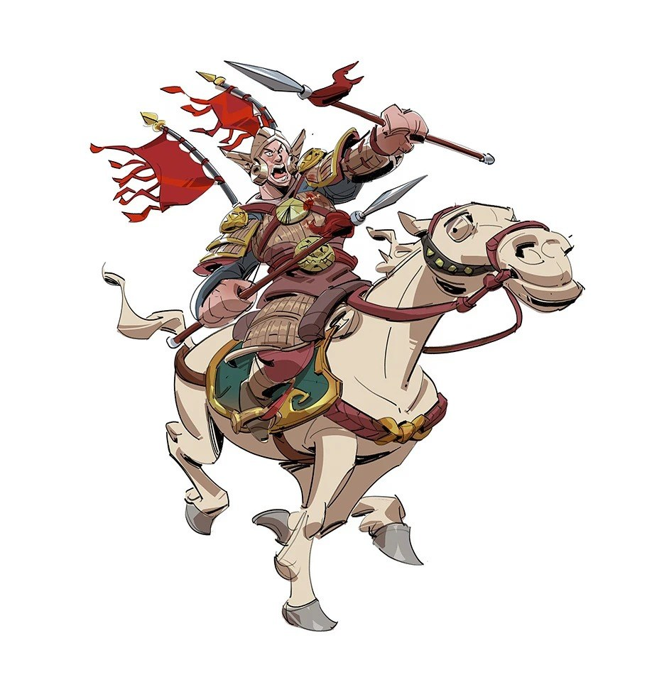
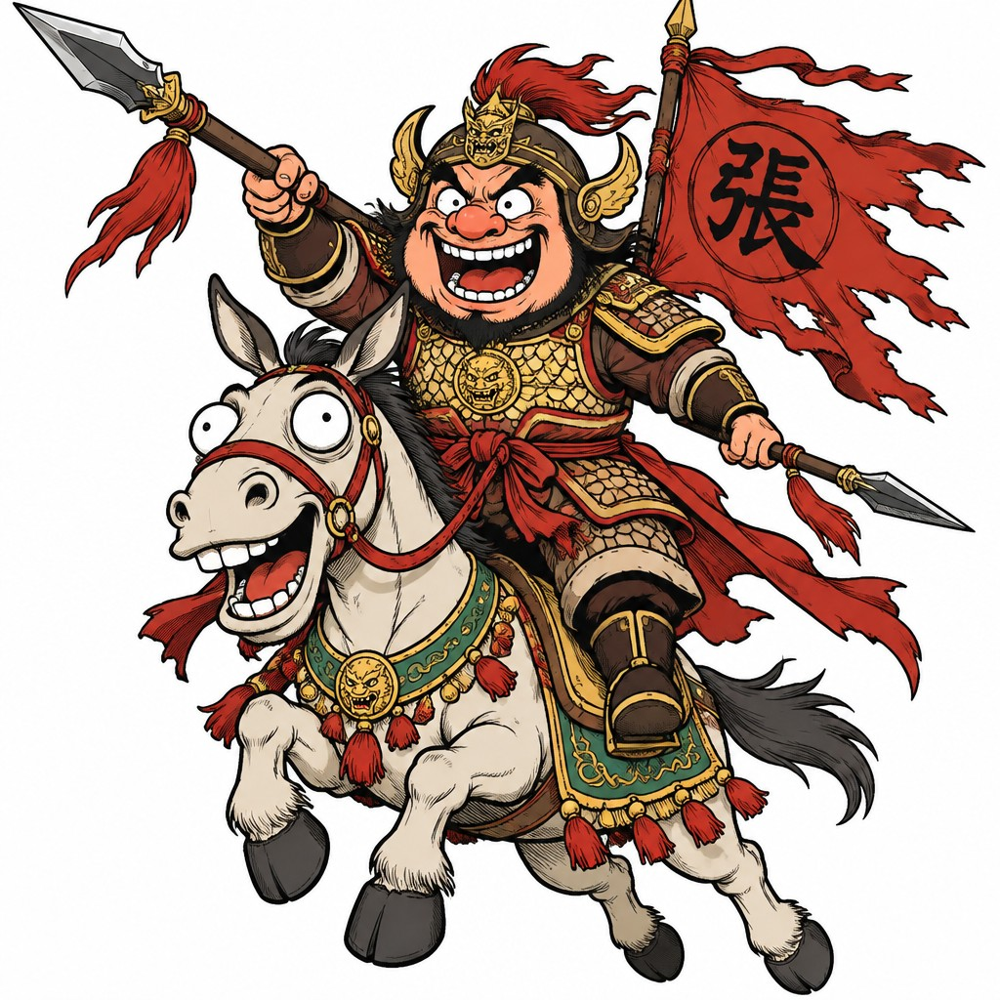
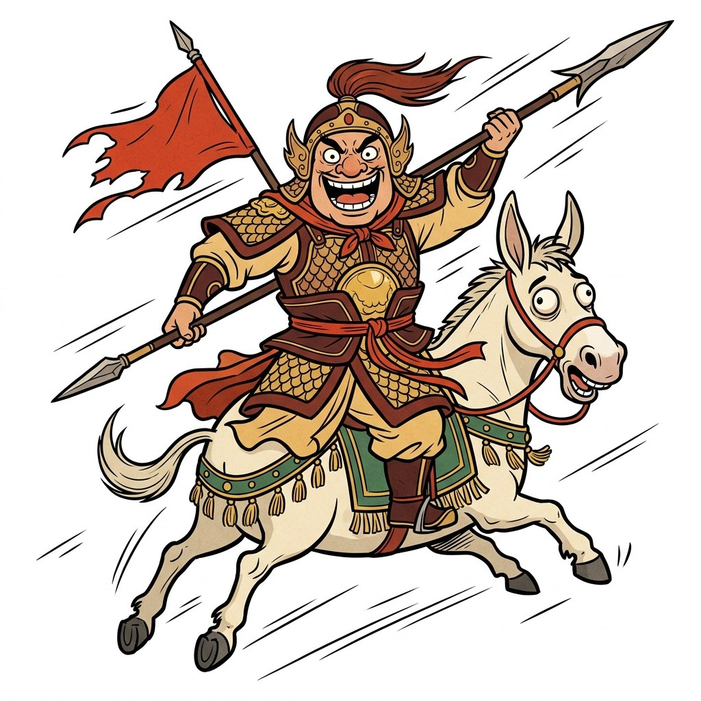
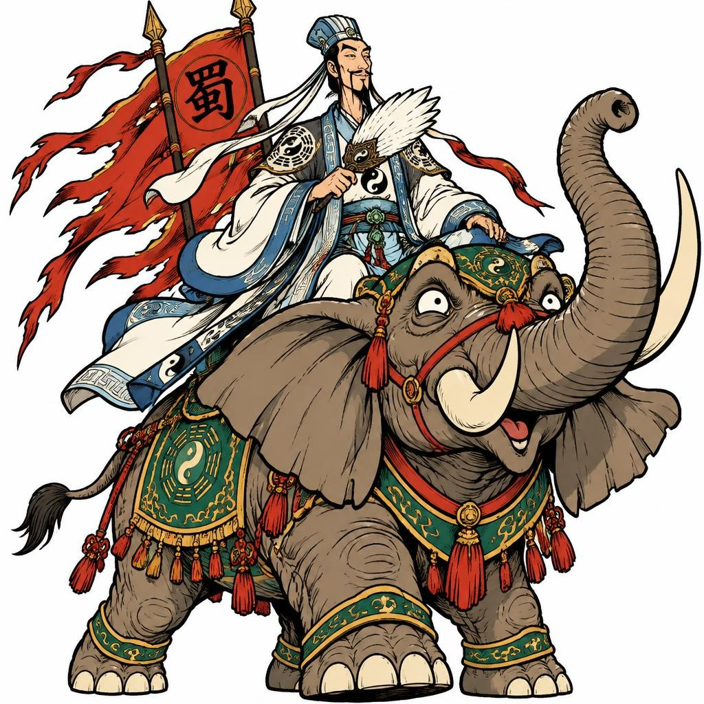
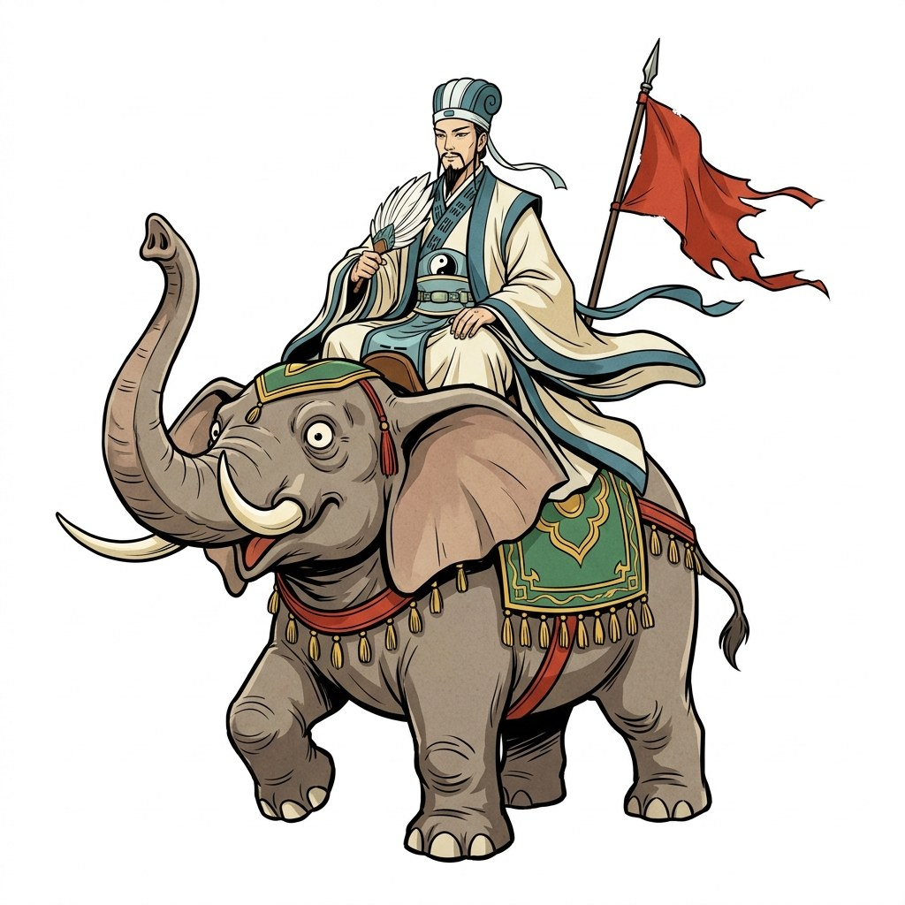
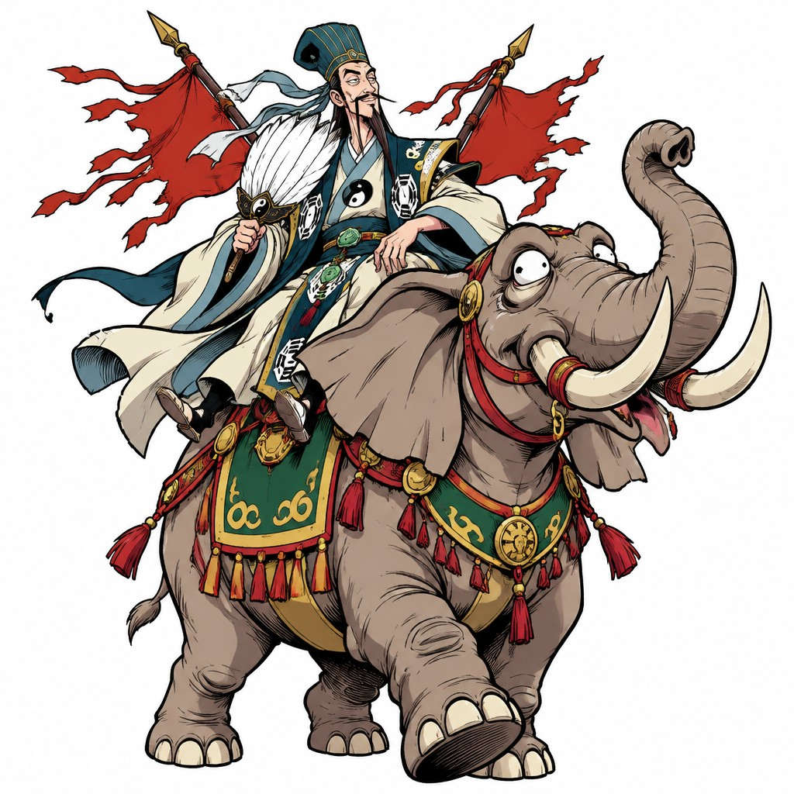
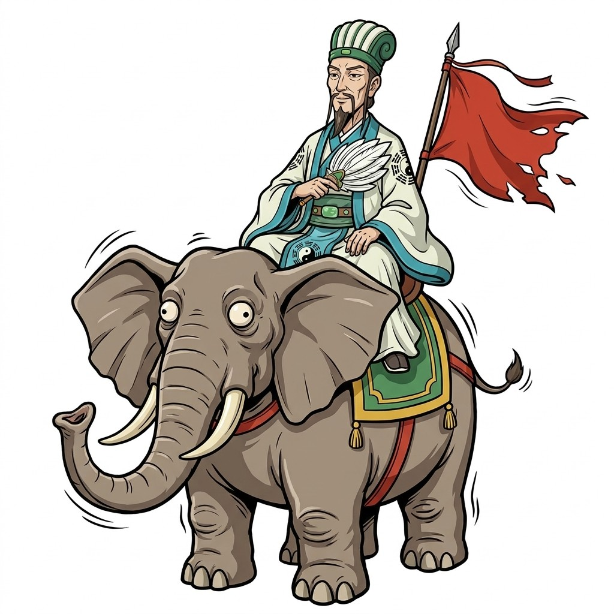

# Image Prompt Studio Skill

简单一句话： 复刻图片风格，模仿风格生图！
结构化 JSON 提示词生成与修改 skill —— 用 **JSON 而非长段自然语言** 控制 AI 生图，实现精准定制、模块化复用与系列作品一致性。提示词同时兼容 **Nano Banana 与 GPT-Image 双模型家族**，生图统一走 **apiz-cli**，识图分析由**运行时 agent** 直接完成。

---

## 实测示例 1 · 参考图 → 提示词 → 双模型出图

> 测试日期：2026-10-14 ｜ 测试图：`E:\三国seedance\_3_LLHAN_来自小红书网页版.jpg`（911×954）

### 第 1 步 · 参考图（运行时 agent 直接读图分析）

不调用任何外部视觉模型 API，由 agent 用自身多模态能力打开图片，按四个维度提取特征：角色特征、场景环境、画面风格、构图与镜头角度。



**分析结论**：夸张讽刺漫画风——粗黑描边 + 平涂赛璐璐上色，米黄暖调打底、朱红点缀；狂笑武将骑米白色驴马、手持双矛冲锋，身后插撕裂红战旗；纯白背景抠图式独立呈现，近方形构图。

### 第 2 步 · 生成的结构化提示词（校验通过）

完整 JSON 见 [`assets/examples/prompt.json`](assets/examples/prompt.json)，结构如下：

```json
{
  "风格模式": "夸张讽刺漫画风格, 粗黑描边, 平涂赛璐璐上色, 三国连环画, 国潮漫画",
  "画面气质": "滑稽, 狂放, 诙谐, 荒诞, 动感十足",
  "场景": {
    "环境": {
      "地点设定": "纯白背景，无任何环境元素，角色与坐骑以抠图式独立呈现",
      "光线": "均匀平光，无投影，仅靠粗描边与固有色塑造体积",
      "天气氛围": "无场景氛围，画面完全聚焦角色本身"
    },
    "主体": {
      "整体描述": "三国猛将骑乘驴马挥矛冲锋的夸张漫画形象，人物与坐骑构成滑稽的双人组合",
      "外形特征": { "身材": "五短精悍，上身粗壮，头身比夸张", "面部": "圆脸大鼻头，咧开大嘴狂笑……", "头发": "头戴三国风格战盔……", "眼睛": "双眼瞪圆放光……" },
      "表情与动作": { "情绪": "狂喜，癫狂，意气风发", "动作": "右手高举长矛作突刺状，左手横握短矛，双腿大张跨骑坐骑……" },
      "服装": { "穿着": "褐红与米黄配色的三国武将甲，鱼鳞纹胸甲配金色护心镜……", "细节": "甲片以粗描边加平涂表现……" },
      "配饰": "手中长矛与短矛各一，身后插着旗杆与撕裂飘动的红色战旗；坐骑为米白色驴马，眼睛圆凸滑稽……"
    },
    "背景": { "描述": "纯白留白背景，无任何场景元素，突出角色与坐骑的完整剪影轮廓", "景深": "无景深，全图等焦……" }
  },
  "相机": { "机位角度": "正面平视，略带仰角……", "构图": "方形构图，角色与坐骑完整居中……", "镜头特性": "标准镜头感……", "传感器画质": "8K 超高清分辨率……" },
  "审美控制": {
    "呈现意图": "三国题材夸张漫画插画，连环画与讽刺漫画风格……",
    "材质真实度": ["粗黑描边加平涂的漫画质感……", "甲片与布料以线条纹理表现……", "整体带轻微纸张印刷质感……"],
    "色彩风格": { "整体色调": "米黄暖调打底，朱红与墨褐点缀……", "对比度": "高对比度，深褐描边与浅色块形成强烈分割……", "特殊效果": "线条飞白与速度线……" }
  }
}
```

### 第 3 步 · 同一份 JSON，双模型出图（apiz-cli）

| GPT-Image（默认路线） | Nano Banana（备选路线） |
| :---: | :---: |
|  |  |
| `apiz/gpt-image-2.5-flare` ｜ quality=low ｜ 1:1 ｜ 1024×1024 ｜ **10 积分** | `service-inference/gemini-nano-banana-2.1` ｜ 1:1 ｜ 1024×1024 ｜ **19 积分** |

两条路线命令：

```bash
# GPT-Image 路线（默认，low 档 10 积分/张）
apiz generate "$(cat prompt.json)" --model apiz/gpt-image-2.5-flare \
  --aspect-ratio 1:1 --params '{"quality": "low"}' --wait --json

# Nano Banana 路线
apiz generate "$(cat prompt.json)" --model service-inference/gemini-nano-banana-2.1 \
  --aspect-ratio 1:1 --wait --json
```

**结论**：同一份结构化 JSON 被两个模型家族正确消费，均还原出漫画描边、狂笑武将、双矛、张字大旗与滑稽坐骑，纯白背景与近方形构图也准确保留——**双模型兼容性实测成立**。

---

## 实测示例 2 · 最小化修改（路径 B）：骑驴武将 → 诸葛亮坐大象

> 测试日期：2026-10-14 ｜ 输入：示例 1 的 `prompt.json` ｜ 修改指令（共 8 个字）：**「改成 诸葛亮坐在大象」**

这一节专门验证路径 B 的核心纪律——**精准打击 + 完全冻结**。用户只说了主体是谁、骑什么，其余一切参数都不许动。

### 第 1 步 · 字段级 diff 核验（程序化比对，非人眼抽查）

把修改前后的两份 JSON 展平成 26 个叶子字段逐一比对：

```
总字段数: 26
改动字段: 11 / 冻结字段: 15 (冻结率 58%)
```

| 改动字段（11 个，全部落在「场景.主体」子树 + 1 条联动语句） | 改动内容 |
|---|---|
| `场景.主体.整体描述` | 猛将骑驴马挥矛冲锋 → 诸葛亮端坐大象 |
| `场景.主体.外形特征.身材` | 五短精悍上身粗壮 → 修长清瘦肩背挺直 |
| `场景.主体.外形特征.面部` | 圆脸大鼻头狂笑 → 清癯长面、三缕长须、沉静含威 |
| `场景.主体.外形特征.头发` | 三国战盔 → 青白纶巾 + 高髻 |
| `场景.主体.外形特征.眼睛` | 瞪圆放光癫狂 → 细长凤眼、沉静睿智 |
| `场景.主体.表情与动作.情绪` | 狂喜癫狂 → 从容悠然、胸有成竹 |
| `场景.主体.表情与动作.动作` | 举矛突刺、跨骑冲锋 → 正襟端坐、轻摇羽扇；坐骑改为四足踏地、长鼻上扬 |
| `场景.主体.服装.穿着` | 褐红武将甲 + 护心镜 → 鹤氅道袍 + 八卦纹长褂 |
| `场景.主体.服装.细节` | 甲片以粗描边平涂 → 宽大衣袖垂坠、衣摆绶带轻扬 |
| `场景.主体.配饰` | 长矛短矛 + 米白驴马 → 白羽扇 + 灰褐巨象（象牙/大耳/绿金鞍毯逐字沿用） |
| `相机.机位角度` | **唯一联动改动**：`略带仰角以强化冲锋气势` → `…以强化端坐的威仪气势`（主体已由"冲锋"变"端坐"，属逻辑冲突修正） |

**逐字冻结的 15 个字段（改动率为 0）**：`风格模式`、`画面气质`、`环境` 全部 3 项（地点设定/光线/天气氛围）、`背景` 全部 2 项、`相机.构图`、`相机.镜头特性`、`相机.传感器画质`、`审美控制` 全部 5 项（呈现意图/材质真实度/色彩风格 3 项）。

> 关键点：用户没提画风，于是「夸张讽刺漫画风格, 粗黑描边, 平涂赛璐璐」「滑稽, 狂放, 诙谐」全部原样留用；用户没提背景，于是「纯白背景抠图式独立呈现」原样留用；连「绿金配色鞍毯缀流苏，配红色缰绳」这类坐骑细节也逐字承袭到新坐骑身上。**只有 6 个字对应的语义范围被动过，另外那 1 条是主体姿态变更后的必然联动。**

### 第 2 步 · 修改后的完整 JSON（校验通过）

完整 JSON 见 [`assets/examples/prompt-modified.json`](assets/examples/prompt-modified.json)，主体块对照如下：

```json
{
  "风格模式": "夸张讽刺漫画风格, 粗黑描边, 平涂赛璐璐上色, 三国连环画, 国潮漫画",   ← 冻结
  "画面气质": "滑稽, 狂放, 诙谐, 荒诞, 动感十足",                                  ← 冻结
  "场景": {
    "环境": { "地点设定": "纯白背景，无任何环境元素，角色与坐骑以抠图式独立呈现", … },  ← 冻结
    "主体": {
      "整体描述": "三国蜀汉丞相诸葛亮端坐于大象背上的夸张漫画形象，人物与坐骑构成从容威严的组合",
      "外形特征": {
        "身材": "身形修长清瘦，肩背挺直，头身比夸张",
        "面部": "清癯长面，三缕长须垂胸，面容沉静含威，唇角带一丝悠然笑意，眉宇间透着运筹帷幄的从容",
        "头发": "头挽高髻，外罩青白两色纶巾，巾角垂落肩侧随风轻扬",
        "眼睛": "细长凤眼，目光沉静悠远，透出洞察世事的睿智"
      },
      "表情与动作": {
        "情绪": "从容，悠然，胸有成竹",
        "动作": "正襟端坐于象背鞍座之上，右手轻摇白羽扇举于胸前，左手虚搭于膝，身体微侧稳坐；坐骑大象四足稳稳踏地，长鼻高高卷起上扬，大耳轻轻扇动"
      },
      "服装": {
        "穿着": "米白与青蓝配色的鹤氅道袍，外罩八卦纹长褂，腰系玉带，胸前有太极纹样",
        "细节": "衣袍以粗描边加平涂表现，宽大衣袖自然垂坠，衣摆与绶带随风轻扬"
      },
      "配饰": "手中轻摇的白色羽扇一柄，身后插着旗杆与撕裂飘动的红色战旗；坐骑为灰褐色巨型大象，大耳如扇，长鼻上扬卷动，象牙弯曲上翘，象眼圆凸滑稽，四蹄粗壮厚重，绿金配色鞍毯缀流苏，配红色缰绳"
    },
    "背景": { "描述": "纯白留白背景，无任何场景元素，突出角色与坐骑的完整剪影轮廓", … }  ← 冻结
  },
  "审美控制": { "呈现意图": "三国题材夸张漫画插画，连环画与讽刺漫画风格，国潮漫画爆款质感", … }  ← 冻结
}
```

### 第 3 步 · 修改稿双模型出图（同一份修改后 JSON）

| GPT-Image（默认路线） | Nano Banana（备选路线） |
| :---: | :---: |
|  |  |
| 纶巾鹤氅、八卦太极袍、白羽扇、端坐巨象、蜀字大旗 | 纶巾长须、太极纹长褂、白羽扇、端坐巨象、红战旗 |
| `apiz/gpt-image-2.5-flare` ｜ quality=low ｜ 1:1 ｜ 1024×1024 ｜ 3m11s ｜ **10 积分** | `service-inference/gemini-nano-banana-2.1` ｜ 1:1 ｜ 1024×1024 ｜ 8m28s ｜ **19 积分** |

```bash
# 修改稿出图（与示例 1 完全相同的命令，只换了输入文件）
apiz generate "$(cat prompt-modified.json)" --model apiz/gpt-image-2.5-flare \
  --aspect-ratio 1:1 --params '{"quality":"low"}' --wait --json

apiz generate "$(cat prompt-modified.json)" --model service-inference/gemini-nano-banana-2.1 \
  --aspect-ratio 1:1 --wait --json
```

**结论**：只改了主体字段，两模型都仍然输出**同一套夸张讽刺漫画风**（粗黑描边 + 平涂 + 纯白抠图式背景 + 方形构图），坐骑顺利从驴马换成大象、人物从狂笑武将换成羽扇纶巾的诸葛亮——**「改主体而不动风格」正是路径 B 的价值：系列作品能靠同一份 JSON 骨架不断换角色，画风不漂移。**（GPT-Image 还自发把战旗写上了「蜀」字，属模型的理解加成，非 JSON 指定。）

### 第 4 步 · 补测修复（2026-10-15）：出图必须带回原图作风格参考

> **Bug**：上面第 3 步的出图命令**没有把参考图传回去**——分析完就把原图丢了，模型只能靠文字描述猜画风。正确做法：提示词既然源自参考图，出图就必须把原图一并传入。本条已固化为路径 C 的硬性规则。

修复后的完整命令（本地原图先 `apiz upload` 转 URL，再按模型传参）：

```bash
# 1. 本地原图 → apiz CDN URL
apiz upload "E:/三国seedance/_3_LLHAN_来自小红书网页版.jpg" --json
#    → { "public_url": "https://cdn-hk.51sux.com/storage/cli-uploads/..." }

# 2. GPT-Image 路线：参数名是 reference_image_urls（1-16 张；image_url / image_urls 均报 400）
apiz generate "$(cat prompt-modified.json)" --model apiz/gpt-image-2.5-flare \
  --aspect-ratio 1:1 \
  --params '{"quality":"low","reference_image_urls":["<public_url>"]}' --wait --json

# 3. Nano Banana 路线：参数名是 image_urls（传入即进入改图模式）
apiz generate "$(cat prompt-modified.json)" --model fal-ai/nano-banana-pro \
  --aspect-ratio 1:1 --params '{"image_urls":["<public_url>"]}' --wait --json
```

**同一份 JSON，无参考图 vs 带参考图对比**：

| 无参考图（第 3 步，有缺陷） | 带参考图（修复后） |
| :---: | :---: |
|  |  |
|  |  |
| 靠文字猜画风：羽扇/太极纹/流苏鞍毯等细节易走样 | 画风与原图高度一致：坐骑继承原图同款**滑稽圆凸眼**、绿金流苏鞍毯、撕裂红战旗、粗描边平涂线条 |

实测数据（2026-10-15）：

| 路线 | 模型 | 耗时 | 消耗 | 结果 |
|---|---|---|---|---|
| GPT-Image | `apiz/gpt-image-2.5-flare` + `reference_image_urls` | 1m42s | 10 积分 | ✅ 1024×1024 |
| Nano Banana 主通道 | `service-inference/gemini-nano-banana-2.1` + `image_urls` | — | — | ❌ 上游 502 ×2（Gemini 上游故障，`apiz tasks get <task_id>` 可查错误） |
| Nano Banana 备选 | `fal-ai/nano-banana-pro` + `image_urls` | 3m01s | 60 积分 | ✅ 1024×1024 |

**结论**：带参考图后，两模型的画风还原度都显著提升——最直观的证据是大象继承了原图驴马的「圆凸滑稽眼」，这种非文字可精确描述的特征只有看得到原图才能画出来。**分析过的参考图 ≠ 用完即弃，出图时必须传回。**

---

## 使用方式

### 触发场景

- 「帮我把这个画面写成结构化提示词」→ 路径 A 生成
- 「把提示词里的冬天改成夏天」→ 路径 B 最小化修改（未触及字段逐字冻结）
- 「参考这张图生成提示词」→ 路径 A + agent 读图分析
- 「用这个提示词出图」→ 路径 C apiz-cli 生图

### 核心命令速查

```bash
# 1. 生成/修改提示词后，校验结构（完整模式）
python scripts/validate_prompt.py prompt.json

# 2. 部分结构预设（如"仅角色"）用部分模式
python scripts/validate_prompt.py prompt.json --partial

# 3. 生图（耗时数分钟，长任务建议后台运行）
apiz generate "$(cat prompt.json)" --model apiz/gpt-image-2.5-flare \
  --aspect-ratio 3:4 --params '{"quality":"low"}' --wait --json

# 4. 从返回 JSON 的 result.images[0].url 下载成品
curl -sL -o out.jpg "<url>"
```

## 目录结构

```
image-prompt-studio/
├── SKILL.md                          # 主文件：四条路径工作流
├── README.md                         # 本文件：实测图文示例
├── scripts/
│   └── validate_prompt.py            # 结构校验器（完整/部分双模式）
├── references/
│   ├── prompt-schema.md              # JSON 字段规范 + 双模型兼容性
│   ├── system-prompts.md             # 生成/修改系统提示词全文
│   ├── options-library.md            # 全量下拉词库 + 线稿专用提示词
│   └── image-generation.md           # apiz-cli 生图操作手册
└── assets/
    ├── presets/                      # 9 套预设范例
    └── examples/                     # 本 README 实测的图文素材
        ├── 01-reference.jpg          #   参考图（骑驴武将）
        ├── 02/03-*.jpg               #   示例 1 双模型出图
        ├── 04/05-*.jpg               #   示例 2 修改稿出图（无参考图，有缺陷的旧版）
        ├── 06/07-*-with-ref.jpg      #   示例 2 第 4 步带参考图重测（修复后）
        ├── prompt.json               #   示例 1 生成的提示词
        └── prompt-modified.json      #   示例 2 最小化修改后的提示词
```

## 来源

本项目灵感参考： `nano-banana-prompt-studio`（PyQt6 桌面端 + Flask Web 端的 Nano Banana Prompt Studio）。生图通道自 2026-10-14 起统一为 apiz-cli（Nano Banana / GPT-Image 双兼容），提示词工程知识（字段规范、生成/修改系统提示词、词库、9 套预设）为本 skill 的核心资产。

特别感谢 https://linux.do 社区支持
